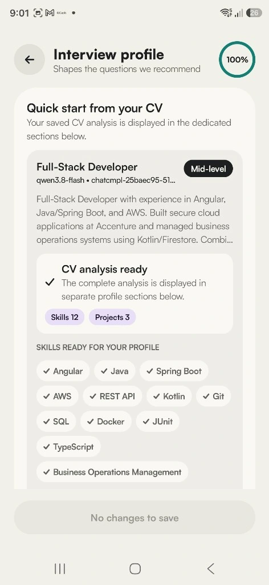
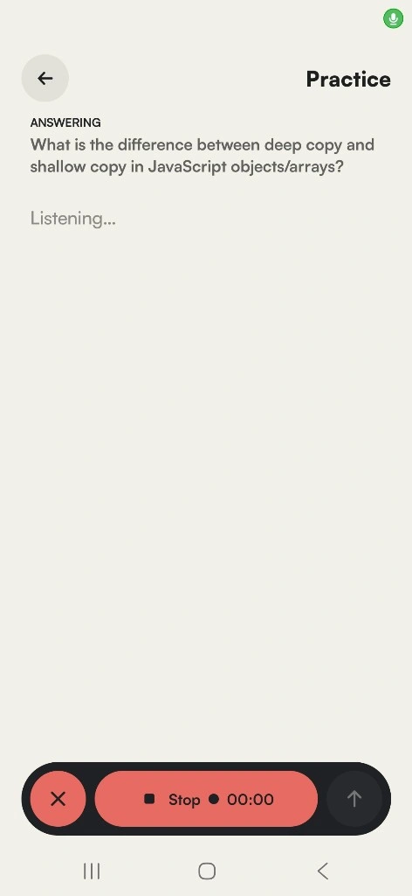
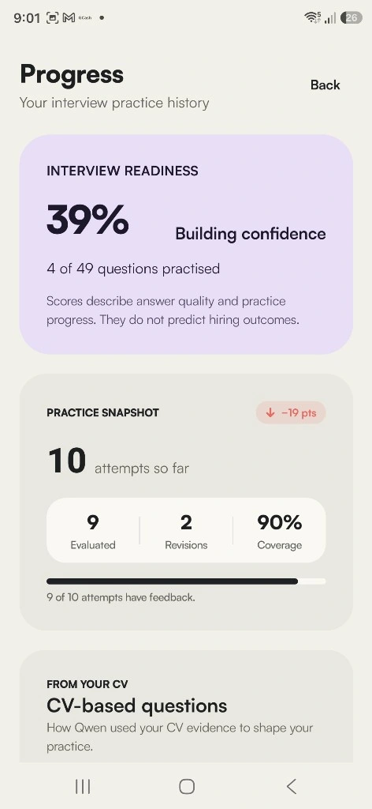
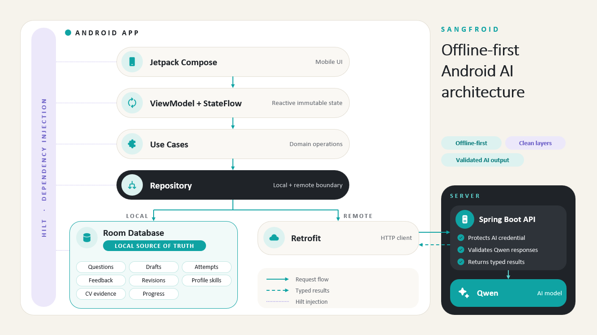
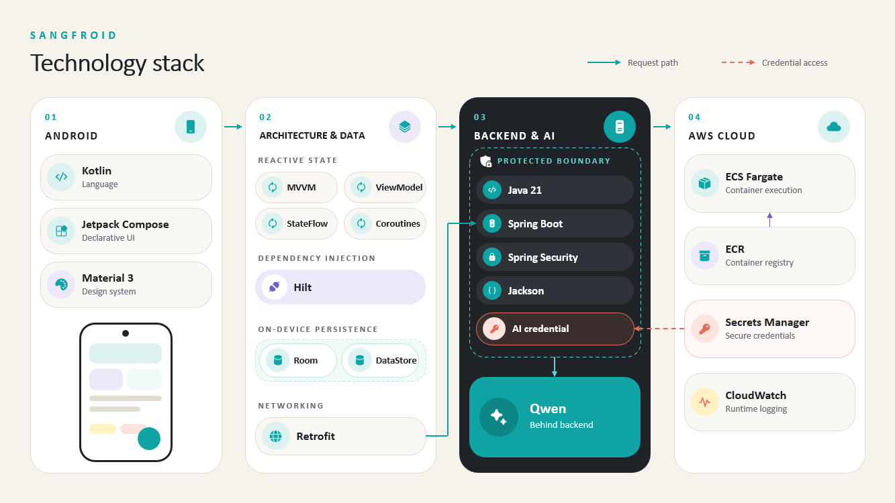
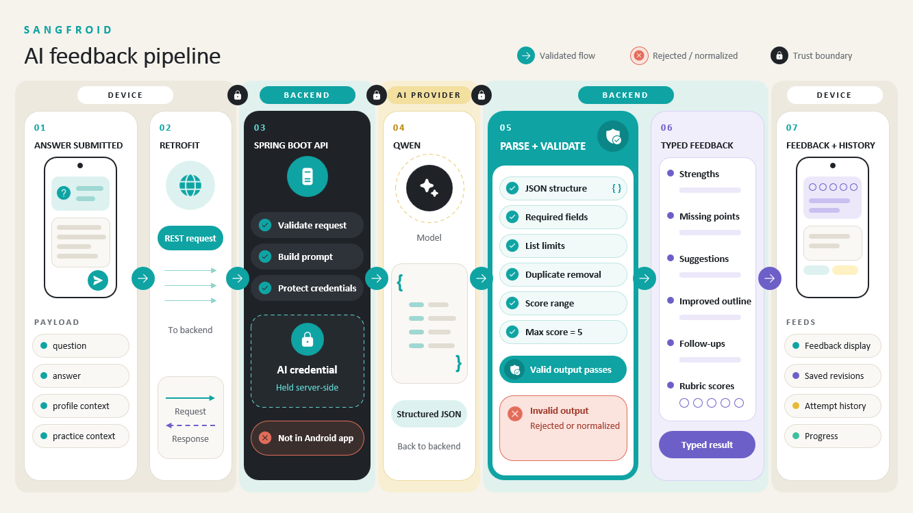
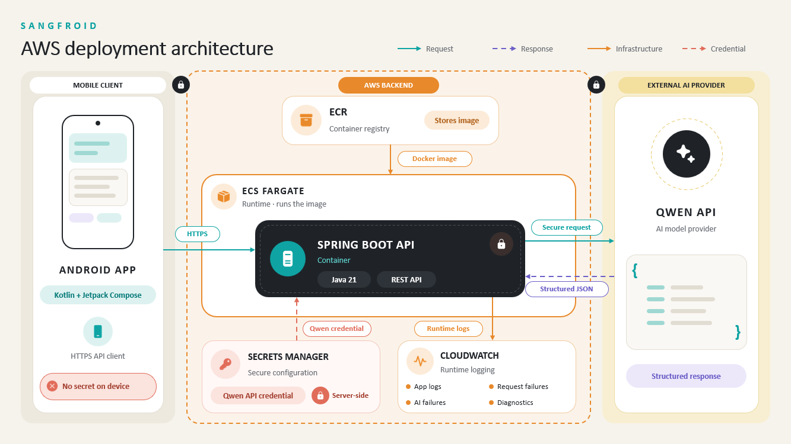

# Sangfroid

### AI-powered interview practice personalized around your experience.

Sangfroid is an **offline-first Android interview preparation app** built with **Kotlin and Jetpack Compose**.

It uses a candidate's **CV, skills, target role, and practice history** to recommend relevant interview questions, then supports the complete practice loop through typed or voice answers, structured AI feedback, saved revisions, attempt history, and progress tracking.

A **Java Spring Boot backend** handles Qwen-powered CV analysis, question generation, ideal-answer guidance, and answer evaluation while keeping AI credentials outside the Android application.

**Core stack:**  
`Kotlin` · `Jetpack Compose` · `MVVM` · `Room` · `Hilt` · `Retrofit` · `StateFlow` · `Spring Boot` · `Qwen` · `AWS`

  

## From CV to Better Answers

Sangfroid turns interview preparation into a continuous practice loop.

<table>
  <tr>
    <td align="center">
      
    </td>
    <td align="center">
      
    </td>
    <td align="center">
      
    </td>
  </tr>
  <tr>
    <td valign="top">
      <strong>1. Personalize</strong>  
      Import CV evidence and build a structured profile from skills, projects, experience, and target-role context.
    </td>
    <td valign="top">
      <strong>2. Practice</strong>  
      Answer recommended or saved interview questions using text or voice, with previous attempts kept as practice history.
    </td>
    <td valign="top">
      <strong>3. Improve</strong>  
      Use structured feedback, saved revisions, score trends, CV coverage, and practice history to decide what to work on next.
    </td>
  </tr>
</table>

## Architecture

Sangfroid uses a layered **MVVM architecture** that keeps the Compose UI, business logic, persistence, and remote AI operations separated.

  

## Technology Stack

Sangfroid was built end-to-end, from the native Android experience and local persistence to the AI backend and cloud deployment.

  

| Area | Technologies |
|---|---|
| **Android** | Kotlin · Jetpack Compose · Material 3 |
| **Architecture** | MVVM · ViewModel · StateFlow · Coroutines · Hilt |
| **Local data** | Room · DataStore |
| **Networking** | Retrofit · REST |
| **Backend** | Java 21 · Spring Boot · Spring Security · Jackson |
| **AI** | Qwen |
| **Cloud** | AWS ECS Fargate · ECR · Secrets Manager · CloudWatch |

## AI Feedback Pipeline

Sangfroid does not send interview answers directly from the Android app to the AI provider.

The Spring Boot backend acts as a controlled boundary between the mobile client and Qwen, keeping credentials off-device and validating AI-generated output before the application uses it.

  

### What happens after an answer is submitted

1. **Android** sends the question, answer, profile context, and practice context through Retrofit.
2. **Spring Boot** validates the request and constructs the evaluation prompt.
3. **Qwen** generates structured interview feedback as JSON.
4. The backend **parses, cleans, normalizes, and validates** the generated response.
5. Valid feedback is returned as typed data and persisted for the Android experience.

The evaluation can include **strengths, missing points, suggestions, an improved outline, an improved answer, follow-up questions, and rubric scores**.

This validation layer is important because LLM output is non-deterministic. Sangfroid handles malformed JSON, blank or duplicate values, unexpected list sizes, invalid rubric scores, and other responses that do not satisfy the application's contract.

## AWS Deployment

Sangfroid's Spring Boot backend is containerized and deployed on AWS so AI credentials and backend processing remain outside the Android application.

  

### What each service does

- **ECR** stores the Docker image for the Spring Boot backend.
- **ECS Fargate** runs the container without requiring a manually managed server.
- **Secrets Manager** provides sensitive configuration such as the Qwen API credential.
- **CloudWatch** captures backend and container logs for monitoring and troubleshooting.

The key separation is:

`Android app → Spring Boot backend → Qwen`

The Qwen credential stays on the backend and is never bundled into the Android application.